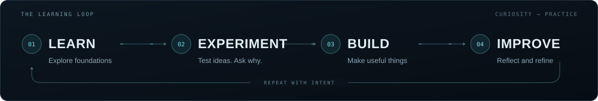

  

  <strong>COMPUTER VISION &nbsp; · &nbsp; DEEP LEARNING &nbsp; · &nbsp; AI RESEARCH &nbsp; · &nbsp; DSA</strong>

  Building intelligent systems, exploring deep learning, and turning research ideas into practical applications.

  <a href="#selected-work">Explore my work</a> &nbsp; / &nbsp;
  <a href="#what-im-working-toward">What I'm learning</a> &nbsp; / &nbsp;
  <a href="mailto:sharanyamondal9@gmail.com">Get in touch</a>

---

### A little about me

I'm **Sharanya**, an aspiring AI/ML engineer who learns by building, experimenting, and asking why a result happened. I'm interested in the space between a research idea and a system that works: comparing approaches, understanding their limitations, and making something useful from what I learn.

My focus is **computer vision and deep learning**, alongside stronger foundations in **data structures, algorithms, and software engineering**. I'm still building those foundations. These repositories are where I put them into practice.

### Selected work

<table>
  <tr>
    <td width="50%" valign="top">
      <h3><a href="https://github.com/Godavenger/SatQuery-AI-SIH26167">01 / SatQuery AI</a></h3>
      
<strong>Computer vision · Earth observation · Research prototype</strong>

      
Querying optical and SAR satellite imagery with visual evidence, confidence estimates, change analysis, and auditable reports.

      
The repository includes evaluation, calibration, and ablation artifacts. A place to explore how model choices affect the reliability of an answer.

      
<code>Python</code> <code>PyTorch</code> <code>Rasterio</code> <code>FastAPI</code>

      
<a href="https://github.com/Godavenger/SatQuery-AI-SIH26167">Explore the project →</a>

    </td>
    <td width="50%" valign="top">
      <h3><a href="https://github.com/Godavenger/driftcheck">02 / driftcheck</a></h3>
      
<strong>Developer tooling · API contracts · Engineering</strong>

      
A Python CLI that checks live APIs against their OpenAPI contracts and publishes conformance reports through GitHub Actions.

      
<a href="https://github.com/Godavenger/driftcheck/actions/runs/38216061128">62 tests passed in CI</a> on 12 October 2026. Reports are available as JSON, Markdown, and HTML.

      
<code>Python</code> <code>httpx</code> <code>JSON Schema</code> <code>pytest</code>

      
<a href="https://github.com/Godavenger/driftcheck">Explore the project →</a> &nbsp; <a href="https://godavenger.github.io/driftcheck/">View live report ↗</a>

    </td>
  </tr>
</table>

### What I'm working toward

| Focus | Questions I'm learning to answer |
| :--- | :--- |
| **Computer vision** | How do preprocessing, representations, and model choices change the result? |
| **Deep learning & research** | What makes a useful baseline? How do I compare experiments and explain their limitations? |
| **AI systems** | How can I connect models, APIs, and interfaces into applications that are useful and testable? |
| **DSA & fundamentals** | Why does an approach work, how much does it cost, and when should I choose something else? |

**Tools I'm working with:** `Python` · `PyTorch` · `scikit-learn` · `FastAPI` · `Git` · `pytest` · `GitHub Actions`

### The way I want to work

  

Start with a question. Build a baseline. Compare the evidence. Finish the project, document what changed, and carry the lesson into the next one.

### Building in the open

Refreshed daily from GitHub's public contribution calendar. <a href="./data/activity.json">View the data</a>.

---

  <strong>Curious Mind. Research-Driven. Builder at Heart.</strong> 
  Learning in public, one thoughtful experiment and one finished project at a time.  
  <a href="https://github.com/Godavenger">@Godavenger</a> &nbsp; · &nbsp;
  <a href="mailto:sharanyamondal9@gmail.com">Email</a>

